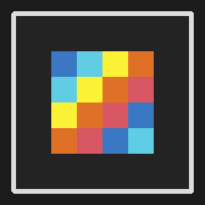

# ThisIsPixel

A focused, fast pixel-art and sprite-animation editor built with **Python 3** and
**PyQt6**. No external image libraries are required: drawing, compositing,
palette management, undo history and `.pxp` persistence are implemented directly
on top of Qt's raster engine.



---

## Untuk pengguna Windows (tanpa Python)

ThisIsPixel tersedia sebagai aplikasi siap pakai. Anda **tidak perlu**
memasang Python atau PyQt.

### Cara memasang (disarankan)

1. Unduh `ThisIsPixel-Setup-2.1.0.exe`.
2. Klik dua kali file tersebut, lalu ikuti wizard berbahasa Indonesia.
3. Jika muncul peringatan **"Windows protected your PC"**, klik
   **More info** lalu **Run anyway**. Peringatan ini muncul karena aplikasi
   belum memiliki sertifikat digital berbayar, bukan karena virus.
4. Setelah selesai, buka ThisIsPixel dari ikon Desktop atau menu Start.

Installer tidak memerlukan hak administrator. Aplikasi dipasang untuk pengguna
Windows saat ini di `%LOCALAPPDATA%\Programs\ThisIsPixel`. Installer juga
menambahkan shortcut menu Start, uninstaller, dan (opsional) asosiasi file
`.pxp` sehingga proyek dapat dibuka dengan klik dua kali. Saat aplikasi
dihapus, file proyek dan pengaturan pribadi Anda **tidak** ikut dihapus.

### Versi portable (tanpa memasang)

Unduh `ThisIsPixel-Portable-2.1.0.zip`, ekstrak seluruh isinya ke satu folder
(misalnya di flash drive), lalu jalankan `ThisIsPixel.exe`. Pengaturan akan
disimpan di `thisispixel.ini` dalam folder yang sama, sehingga tidak menyentuh
registry Windows.

Panduan lengkap berbahasa Indonesia juga terpasang bersama aplikasi
(`Panduan Singkat.txt`) dan dapat dibuka kapan saja dari menu
**Help > Panduan & Tips** atau tombol **F1**.

---

## Highlights

### Drawing
- **Pencil (B)** with brush sizes 1-32 and source-over opacity.
- **Eraser (E)** that restores true transparency.
- **Straight Line (L)**, **Rectangle (U)** and **Ellipse (O)** with live preview
  and outline/filled modes. Pixel-perfect Bresenham and span-based ellipse
  rasterization (no gaps, no diagonal drift).
- **Bucket Fill (G)** with scanline flood fill, tolerance 0-255 and
  selection-aware clipping.
- **Eyedropper (I / Alt+Click)** that samples the active layer first and falls
  back to the composite.
- **Marquee (M)** with move, copy, cut, paste and delete. All operations are
  undoable and use an internal pixel-exact clipboard plus the system clipboard.
- **Spray (S)** with radius and density controls.
- **Radial palette menu** on right click with quick tools and recent colors.

### Canvas
- Smooth zoom from 5% to 3200% (`Ctrl+Wheel`, `Ctrl +`, `Ctrl -`) and
  **zoom to fit** (`Ctrl+0`).
- Pan with `Space + Drag` or the middle mouse button.
- Pixel grid (auto-hidden below 400%) and configurable tile grid.
- Navigator mini-map with a live viewport indicator; click or drag to navigate.
- All drawing respects the active selection and locked/hidden layers.

### Layers
- Unlimited layers per frame, each with thumbnail, opacity, visibility and lock.
- Add, duplicate, delete, move up/down, merge down and rename (double-click or
  context menu).
- Every structural action is a `QUndoCommand` - full undo/redo for layers,
  opacity, visibility, lock order, renames and merges.

### Animation
- Multi-frame timeline with cached thumbnails and frame reordering.
- Playback with adjustable FPS (1-30), loop toggle and frame stepping.
- **Onion skin** (previous frame 30%, next frame 15%) rendered *behind* the
  active frame so artwork stays readable.

### Color
- Built-in SV/Hue color picker, hex (RGB or ARGB) input and live RGB readout.
- Editable 32-color palette with recent-color history.
- Import/export GIMP `.gpl` and JASC `.pal` palettes.
- The palette is stored inside the `.pxp` document.

### Safety and files
- `.pxp` project format (JSON + base64 PNG layers) with validated loading and
  atomic writes (`.tmp` + replace, so a crash cannot corrupt the previous save).
- **Autosave** to `name.pxp.autosave` (interval configurable, `0` disables) and a
  recovery prompt on the next launch.
- Unsaved-changes prompts on close, new, open and recent-file actions.
- Recent-files menu with automatic pruning of missing files.
- PNG export at 1x-32x with nearest-neighbour scaling.
- Sprite-sheet export (all frames in one horizontal strip).

### Interface
- Dock-based workspace with persistent geometry/layout.
- Native Fusion checkboxes, HiDPI support, procedural vector tool icons and a
  procedural application icon.
- Preferences: theme, default canvas size, initial zoom, pixel/tile grids, tile
  size, autosave interval and default export scale.
- Indonesian first-run welcome guide (also available via **Help > Panduan &
  Tips** / `F1`) and `.pxp` files can be opened from the command line or by
  double-clicking them after installation.

---

## Requirements

- Python 3.10 or newer
- PyQt6 6.6 or newer

```bash
pip install -r requirements.txt
```

## Run

```bash
python main.py
```

### Portable settings

Preferences are stored in the platform-native location (the Windows registry,
`~/.config` on Linux, a plist on macOS). Two overrides are supported:

* Set `THISISPIXEL_SETTINGS` to an INI file path.
* Place a file named `thisispixel.ini` next to `ThisIsPixel.exe` (or next to
  `main.py` when running from source). It is detected automatically, which is
  what the portable ZIP uses.

```powershell
$env:THISISPIXEL_SETTINGS = "$PSScriptRoot\thisispixel.ini"
python main.py
```

The test suite uses the same mechanism to point settings at a throw-away temp
file, so running tests never modifies your real preferences.

## Tests

The test suite uses only the Python standard library (`unittest`) and runs
headless through Qt's `offscreen` platform plugin:

```bash
python -m unittest discover -s tests -v
```

Coverage includes the raster algorithms, flood fill, project save/load and
validation, every undo command, canvas strokes (pencil/bucket/drag), selection
clipboard and moves, layer rename/move/opacity/merge, frame reordering,
palette persistence and GPL/JASC round-trips, PNG and sprite-sheet export,
preferences, zoom limits, autosave and unsaved-change prompts.

## Build and release (Windows)

```bash
pip install -r requirements-dev.txt
python make_icon.py          # regenerates asset/thisispixel.ico (7 sizes) + .png
python build_release.py --nsis "C:\Program Files (x86)\NSIS\makensis.exe"
```

`build_release.py` produces everything needed for distribution:

| Artifact | Purpose |
| --- | --- |
| `dist/ThisIsPixel/` | Fast-starting onedir application (used by the installer) |
| `dist/ThisIsPixel-Setup-2.1.0.exe` | Per-user Indonesian installer (no admin) |
| `dist/ThisIsPixel-Portable-2.1.0.zip` | Portable copy; settings stay in `thisispixel.ini` |

The installer is compiled with **NSIS 3.x** using `installer/ThisIsPixel.nsi`.
Pass `--nsis` or set `NSIS_HOME`; if NSIS is missing, the app and portable ZIP
are still built and a hint is printed. Useful flags: `--skip-app`,
`--skip-installer`, `--skip-portable`.

The installer writes only to `HKCU`, installs into
`%LOCALAPPDATA%\Programs\ThisIsPixel`, and adds Start Menu shortcuts, an
optional Desktop shortcut, an optional `.pxp` file association, and an entry in
*Settings > Apps*. Uninstalling keeps user projects and preferences.

For a single-file executable instead (slower first start, more likely to trip
antivirus heuristics), build `main.spec`:

```bash
pyinstaller --clean --noconfirm main.spec
```

The result is `dist/ThisIsPixel.exe`. Both specs disable UPX (safer with Qt) and
embed the generated icon and `installer/version_info.txt` metadata.

---

## Keyboard shortcuts

| Action | Shortcut |
| --- | --- |
| Pencil / Eraser | `B` / `E` |
| Line / Rectangle / Ellipse | `L` / `U` / `O` |
| Bucket / Eyedropper / Spray | `G` / `I` / `S` |
| Marquee | `M` |
| Select all / Deselect | `Ctrl+A` / `Ctrl+D` |
| Cut / Copy / Paste | `Ctrl+X` / `Ctrl+C` / `Ctrl+V` |
| Delete selection content | `Delete` / `Backspace` |
| Zoom in / out / fit | `Ctrl +` / `Ctrl -` / `Ctrl+0` |
| Pan | `Space + Drag` or middle mouse |
| Undo / Redo | `Ctrl+Z` / `Ctrl+Y` (or `Ctrl+Shift+Z`) |
| New / Open / Save / Save As | `Ctrl+N` / `Ctrl+O` / `Ctrl+S` / `Ctrl+Shift+S` |
| Export PNG / sprite sheet | `Ctrl+E` / `Ctrl+Shift+E` |
| Play / pause animation | `Ctrl+Space` |
| Previous / next frame | `Ctrl+Left` / `Ctrl+Right` |
| Preferences | `Ctrl+,` |
| Panduan & Tips (Indonesian guide) | `F1` |
| Radial menu | Right click on canvas |

Single-letter tool shortcuts are ignored while a text field is focused, so you
can type in the hex input without switching tools.

---

## Project structure

```
ThisIsPixel/
├── main.py          # MainWindow, menus, docks, autosave, recovery, export
├── models.py        # Layer, Frame, Project, .pxp I/O, DrawStrokeCommand
├── commands.py      # Undoable layer and frame commands
├── app_settings.py  # Native/portable QSettings store (THISISPIXEL_SETTINGS)
├── tools.py         # Tool enum, raster algorithms, options bar, icons
├── canvas.py        # QGraphicsView canvas, selection, mini-map, radial menu
├── layers.py        # Layer list model/delegate and undoable actions
├── timeline.py      # Filmstrip, playback, onion skin, frame commands
├── palette.py       # Color picker, swatch grid and palette file I/O
├── dialogs.py       # Preferences, new-project and welcome dialogs
├── styles.py        # Fusion palette + dark QSS theme engine
├── version.py       # Application name and version (single source)
├── make_icon.py     # Regenerates asset/thisispixel.{png,ico}
├── build_release.py # Builds onedir app, NSIS installer and portable ZIP
├── tests/           # Stdlib unittest suite
├── main.spec        # PyInstaller onefile definition (power users)
├── main_onedir.spec # PyInstaller onedir definition (installer/portable)
├── installer/       # NSIS script, version info, Indonesian quick guide
└── requirements*.txt
```

## `.pxp` format

`.pxp` files are UTF-8 JSON documents with this shape (version `2.1`):

```json
{
  "version": "2.1",
  "width": 32,
  "height": 32,
  "active_frame_idx": 0,
  "active_layer_idx": 0,
  "palette": ["#ff000000", "#ffffffff"],
  "frames": [
    {
      "width": 32,
      "height": 32,
      "layers": [
        {
          "name": "Layer 1",
          "visible": true,
          "locked": false,
          "opacity": 1.0,
          "image_b64": "<base64 PNG>"
        }
      ]
    }
  ]
}
```

Older `2.0` documents are accepted. Files are validated on load (version,
dimensions, frame list, image dimensions) and written atomically.
